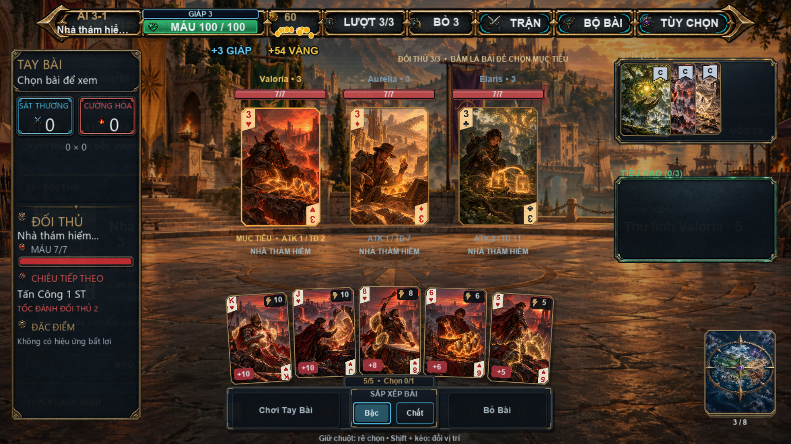
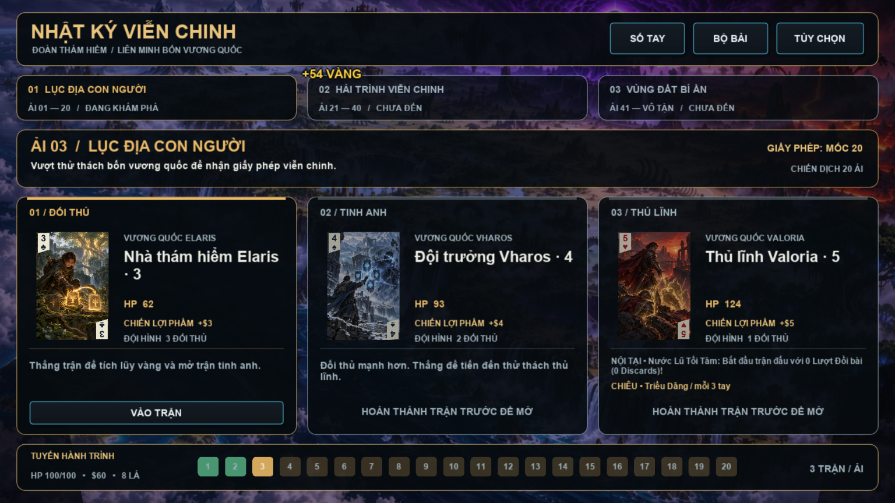
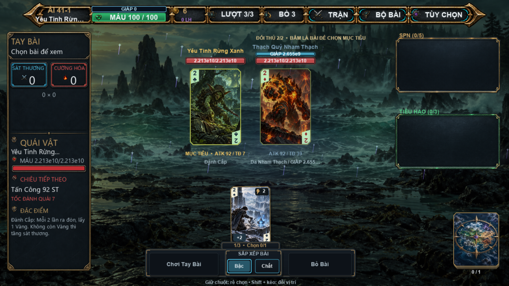
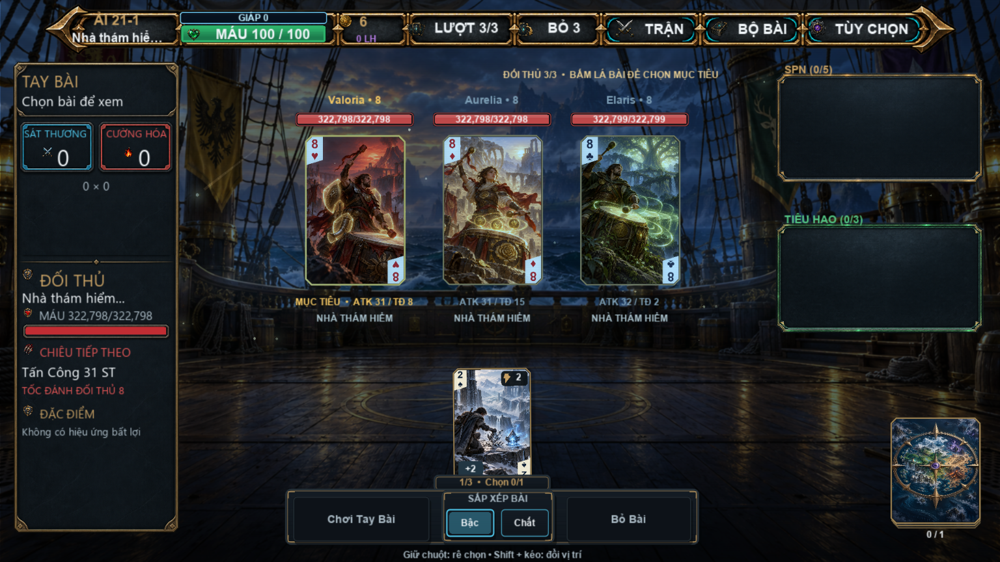
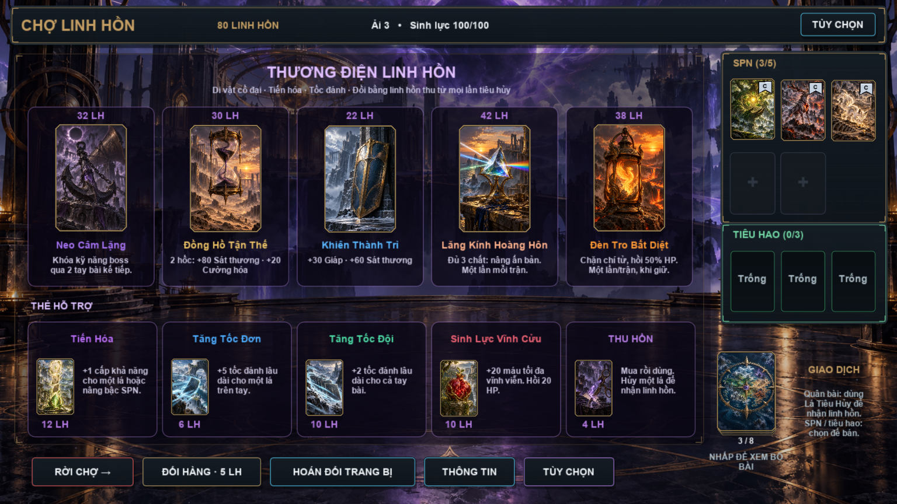
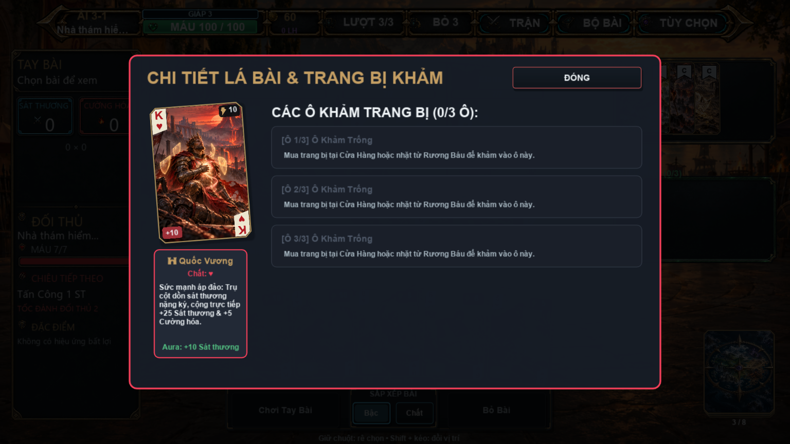
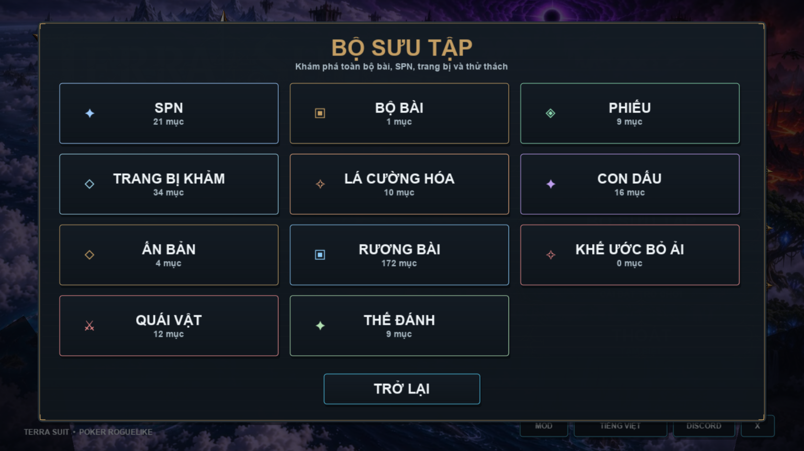

# 🃏 LUA.TCG — Poker Roguelike

**beta 0.144.0** · Lua / LuaJIT · LÖVE 11.5 · [MIT](LICENSE)

Game thẻ bài roguelike kết hợp thế bài Poker, xây dựng bộ bài và chiến đấu theo lượt. Từ bốn vương quốc trên lục địa, bạn giành giấy phép viễn chinh, lên tàu và khám phá vùng đất bí ẩn trong thế giới fantasy phương Tây.

## 📸 Hình ảnh trực quan

Ảnh chụp mới từ game chạy bằng LÖVE, ngày **05/10/2026**. Một số màn dùng bộ bài và tài nguyên dựng sẵn trong chế độ capture để minh họa các tính năng về sau.

| Chọn ải viễn chinh | Khám phá vùng đất bí ẩn |
| :---: | :---: |
|  |  |

| Hải trình viễn chinh | Chợ linh hồn |
| :---: | :---: |
|  |  |

| Soi chi tiết lá bài | Bộ sưu tập |
| :---: | :---: |
|  |  |

## Mới trong beta 0.144.0

- Bốn boss người tự do: **Quan Chấp Cấm Thế**, **Kẻ Gạch Tên**, **Kẻ Thách Tử**, **Giám Quan Tước Phẩm**; tranh và cơ chế riêng.
- SPN **Kẻ Xóa Vương Quyền**: tiến hóa cộng +5 Sát thương/+5 Cường hóa mỗi cấp; chủ động tiêu hủy trong balo để phong ấn năng lực boss đến hết trận.
- Đồng bộ khóa thế/quân/bậc SPN với dự báo điểm, sao chép, giao diện và lưu/tải.
- Chi tiết: [boss tự do](docs/FREE_HUMAN_BOSSES.md), [SPN phong ấn boss](docs/SPN_BOSS_SEAL.md).

## Mới trong beta 0.143.0

- Bốn thực thể vương quốc: phong ấn chất bài và tăng sức mạnh theo tay đang cầm.
- Tốc độ game ×1/×2/×4; nhịp ×1 chậm hơn, giữ input/âm thanh theo thời gian thực.
- Giới hạn SPN bán trong shop ở C–L; lá Tiến Hóa cho SPN dùng lượt tích khi cùng hạ boss.
- Đồng bộ giá trị bán lại/đổi đồ, nâng UI khảm trang bị và nghi thức Tượng Cổ.
- Phản hồi trạng thái ngay trên lá, nâng chất âm SFX/Niệm/phần thưởng.

## Mới trong beta 0.142.0

- HP ba trận ải đầu **50/100/150**; dùng chung công thức HP cho chiến dịch và preview.
- Hai ô SPN/trang bị Shop Nhỏ đổi chỗ sau mỗi reroll thành công, giữ qua lưu/tải.
- Loot bỏ rương quân bài, vẫn giữ quân bài lẻ và các nhóm thưởng khác.
- Thêm kiểm tra bộ nhớ preview/soak; sửa launcher Windows chạy từ đúng thư mục game. Xem [ghi nhận bộ nhớ](docs/MEMORY_AUDIT.md).

## Mới trong beta 0.141.0

- Bộ Bài Đỏ khởi đầu **5 lá đủ bốn chất**, rút 3 lá; điều chỉnh HP địch, hồi HP sau thắng, giá shop và mốc mở SPN hiếm.
- Shop đầu có Đá Tam Kích T1 giá 12 vàng, mua một lần/run; hỗ trợ cặp shop và giữ trạng thái qua lưu/tải.
- AI địch phối hợp hỗ trợ, dùng vật phẩm theo tình huống, ghi nhớ đòn đã nhận; ý định vẫn được báo trước.
- Màn xem bộ bài mới, xem trước đối thủ chi tiết hơn và inspector dễ đọc trên màn hình nhỏ.
- Chi tiết cân bằng và giới hạn mô phỏng: [báo cáo đã áp dụng](docs/BALANCE_APPLIED_REPORT.md).

## Mới trong beta 0.140.0

- **Tượng Cổ**: sự kiện hiến máu đổi nâng cấp/ngẫu nhiên; lưu lựa chọn và tiến độ.
- **Lãnh Địa Máu**: nhánh bí mật tám trận, tám loại địch và boss Vương Huyết; thắng chọn một SPN có sức mạnh ×4 rồi quay lại hành trình chính. Xem [quy tắc](docs/ANCIENT_STATUE.md).
- **10 boss nhân loại** với nội tại, kỹ năng và tranh riêng; chọn boss và kết quả ảnh hưởng bộ bài được giữ qua lưu/tải. Xem [danh mục boss](docs/HUMAN_BOSSES.md).
- Nâng trần tiến hóa quân bài lên **10**; thêm 21 tranh/nền Continental và khung cấp cao.

## Mới trong beta 0.139.0

- Ba SPN: **Song Quang Hội Tụ**, **Kẻ Dệt Số**, **Sứ Giả Khảo Luyện**; công thức AURA và nhiệm vụ tiến hóa riêng, hỗ trợ lưu/tải.
- **Mũi Thép** (+5 Sát thương), **Mảnh Hổ Phách** (+1 Cường hóa), công thức chế tạo và nguồn hàng cập nhật.
- Âm thanh/hiệu ứng đánh hụt riêng; nâng cấp khung, chữ số, hốc khảm và kho đồ địch.
- Giữ các tối ưu khởi động, RAM và tài nguyên từ beta 0.138.2.
