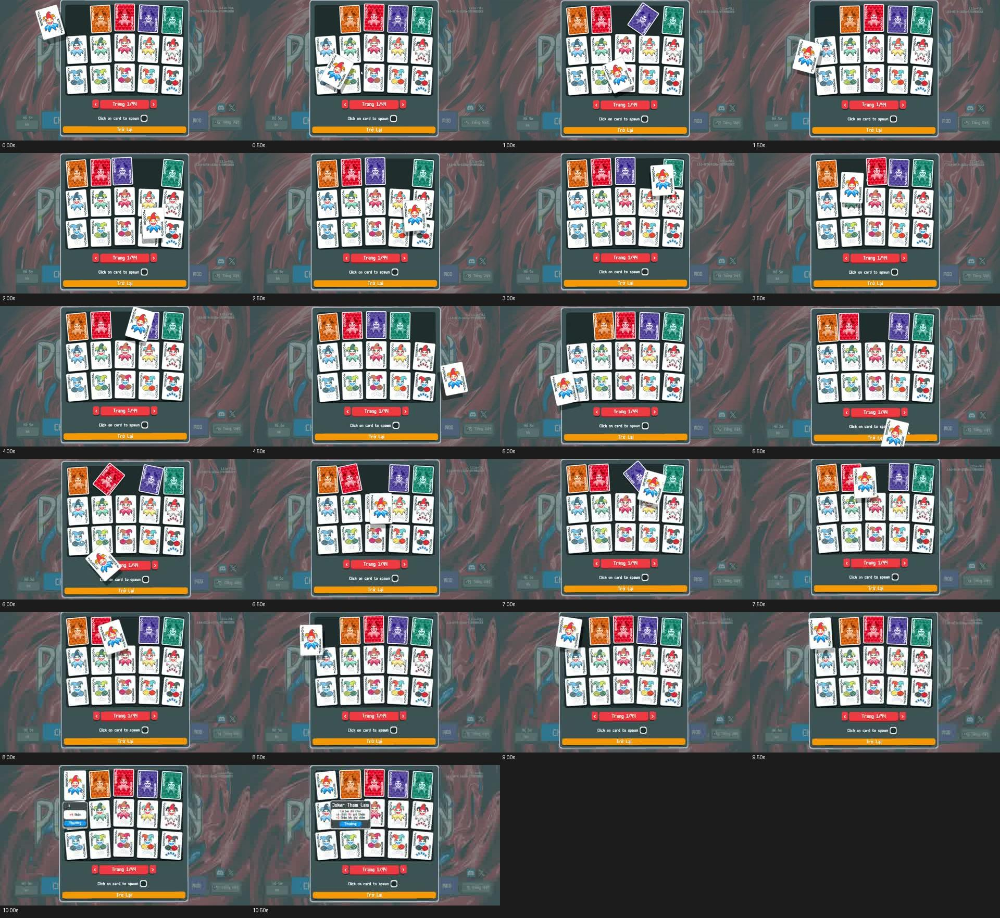
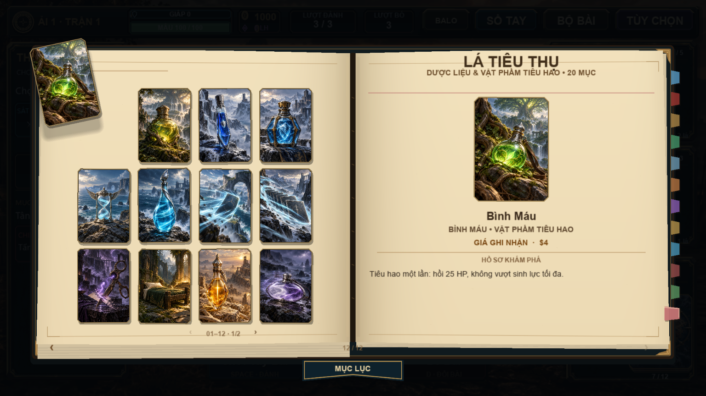

# Kéo thả bài theo keothabai.mp4

Tham chiếu người dùng: `C:\Users\Nhật Nam\Videos\Captures\keothabai.mp4`.
Video dài 10,90 giây, 1918×1078, 30 FPS. Phân tích bằng các khung hình cách nhau
0,5 giây và chuỗi cận cảnh 15 khung/giây ở đoạn 5,6–6,2 giây.

## Những gì thấy trong video

- **Nhấc bài:** lá Joker trắng tách khỏi hàng, lớn hơn lá nằm trên bảng một chút.
  Tranh, chỉ số góc và cạnh lá chuyển động thành một khối.
- **0–4 giây:** lá được kéo qua các hàng. Vị trí đi theo con trỏ nhanh; hướng
  nghiêng phản ứng chậm hơn vị trí nên lá có cảm giác có trọng lượng.
- **4–6,2 giây:** đường kéo đổi hướng nhiều lần và đi ra ngoài bảng. Lá vẫn nằm
  trên cùng, không bị cắt bởi vùng danh sách. Các khung 5,6–6,2 giây cho thấy góc
  nghiêng thay đổi liên tục, không bật qua hai tư thế cố định.
- **6,2–9,5 giây:** đổi hướng và dừng ngắn làm góc nghiêng đi qua phương thẳng
  đứng rồi quay về. Khi tay di chuyển nhanh, góc lệch có thể lên vài chục độ;
  khi chậm lại, bài gần thẳng đứng.
- **Khoảng 10 giây:** lá trở về vị trí hàng trên; tới 10,5 giây đã ổn định và
  phần mô tả xuất hiện. Không nhìn rõ thời điểm nhả chuột nên đây là quan sát
  nhịp chuyển động, không phải phép đo chính xác thời gian spring của video.
- **Bóng:** bóng tối lệch xuống dưới/phải, cùng hình chữ nhật và hướng của lá.
  Khi nhấc, khoảng cách bóng và cạnh bài rõ hơn; khi nằm xuống, bóng thu gần.
  Bóng không phát sáng và không làm mờ tranh. Nền video khá tối nên thông số
  độ mềm/alpha dưới đây là lựa chọn tái hiện, không phải dữ liệu trích xuất.

## Áp dụng trong game

`src/card_physics.lua` điều khiển tư thế trình bày chung; các handler hiện có
tiếp tục xử lý chọn bài, sắp xếp ô, trang bị và giao dịch.

| Thành phần | Cách tái hiện |
| --- | --- |
| Bám chuột | Spring vị trí MEDIUM: stiffness 1100, damping 58; giữ vận tốc khi đổi hướng |
| Nghiêng | Vận tốc chuột được làm mượt + khoảng cách còn trễ; spring góc 210/19 |
| Giới hạn góc | Mục tiêu ±0,38 rad, khoảng ±22°; cho phép vượt nhẹ lúc hãm |
| Nhấc | Phóng 7%, nâng 10 đơn vị layout; chuyển trạng thái liên tục |
| Biến dạng | Stretch theo tốc độ, tối đa 2,5%; shear dọc nhẹ |
| Bóng | 8 lớp hình bo góc; tách tối đa 18 đơn vị thêm vào offset gốc; mềm dần theo độ nhấc |
| Chiếu bóng | Vẽ trước scale/shear mặt bài, góc bóng bằng 80% góc mặt bài |
| Thả | Giữ vận tốc, thu độ nhấc và bóng, trượt về ô hiện tại; giữ trên cùng tới khi ổn định |
| Viền | Tranh, khung Continental và viền chọn đi theo cùng ma trận cuối |
| Input | Ngưỡng kéo được ghi nhớ suốt một lần giữ; kéo quay lại điểm đầu vẫn là thao tác kéo |
| Bộ bài | Nhấp mở inspector khi nhả; kéo không mở inspector |

Tất cả số đo dùng layout logic **1280×720**, sau đó game phóng ra canvas/cửa sổ.
Spring dùng nghiệm theo thời gian, không cộng bước phụ thuộc số FPS.
Trạng thái vật lý nằm ngoài dữ liệu lá bài và save.

Các nhóm UI dùng cùng tư thế và bóng: quân bài, mặt sau, SPN, tiêu hao, ITM,
hàng cửa hàng, đặc quyền, bài thưởng/rương, bộ sưu tập và preview, bộ bài,
inspector, balo, kho mở rộng, xưởng trang bị, bảng tiến hóa, đổi hàng và The Void.
Balo/kho mở rộng không còn tự vẽ thêm một lá dính trực tiếp vào chuột.

Các cảnh chia bài, lật thưởng, đánh và tan biến vẫn giữ quyền điều khiển hoạt
ảnh trong giai đoạn đó; lá sẵn sàng tương tác mới nhận thao tác kéo. Hiệu ứng
trình bày không tạo thêm luật di chuyển hoặc giao dịch cho các lá đó.

## Kiểm chứng

- `lovec.exe . --test-hand-motion`: spring, hover/chọn và 30/60/120/144 FPS.
- `lovec.exe . --test-card-motion`: renderer/viền chung và biến đổi tọa độ.
- `lovec.exe . --test-card-drag`: input thật qua các họ bài, quán tính, nghiêng,
  nhấc/thả, trả về ô, bóng mềm đo bằng pixel; kiểm tra không mua hàng/tốn lượt
  chỉ vì kéo thử.
- `lovec.exe . --test-expanded-inventory`: chọn đúng SPN, đổi ô, khóa ô,
  đích không hợp lệ, hết lượt và chi phí hành động.
- `lovec.exe . --test-hand-drag-select`: kéo chọn, cảm ứng, Shift đổi chỗ.
- `lovec.exe . --test-backpack` và `--test-card-inspector`: luồng balo/chi tiết.

Thêm `--record-card-drag` khi chạy bài kiểm tra kéo để ghi khung hình vào
`.tmp/drag-reference/`. Không ghi save của người chơi.

Đã qua 23 trường hợp ở UI chính/toàn bộ rương và 4 trường hợp đổi hàng/The
Void; kiểm tra giao dịch ở 5 loại shop cũng qua. Các phép kiểm tra renderer,
viền, kéo chọn, balo, inspector và kho mở rộng đều qua trên Windows.
Chưa thử trên điện thoại thật.

[Video minh họa trong game](card_drag_demo.mp4)

