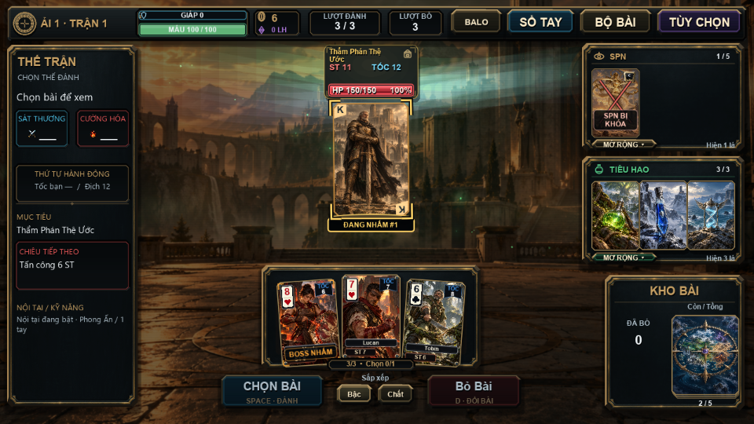
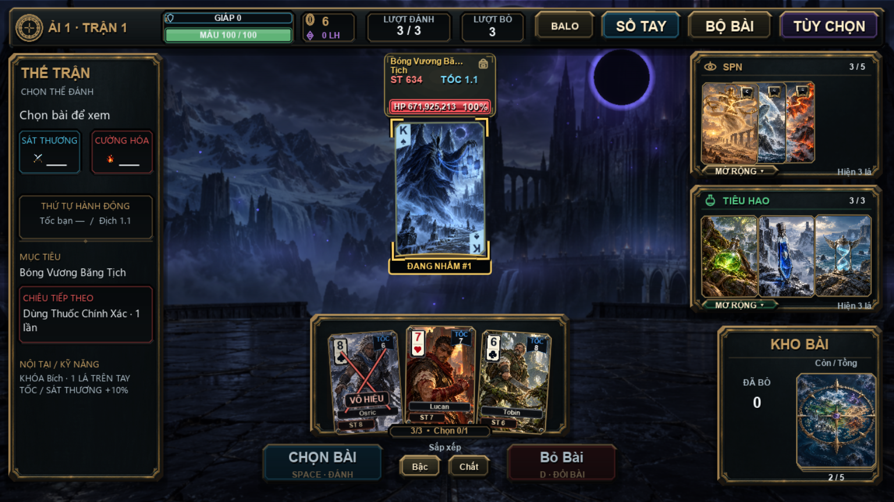
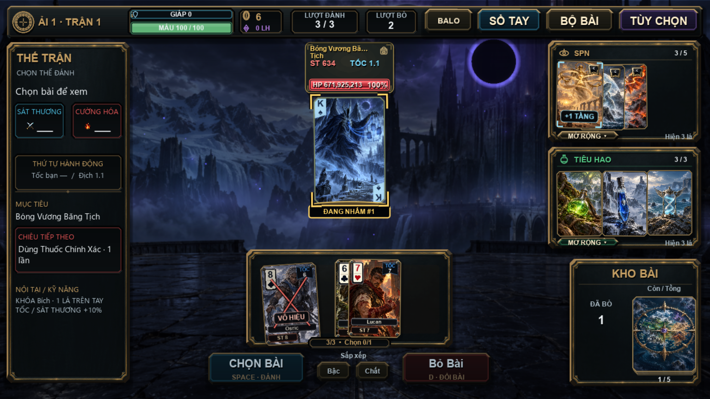
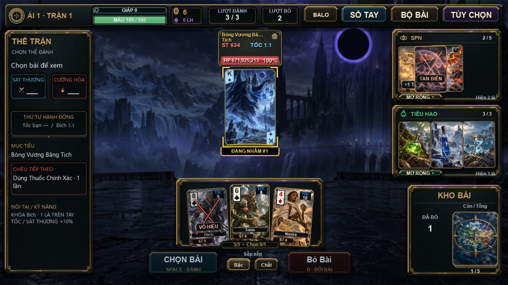

# Phản hồi trực tiếp trên lá bài

Bản sửa theo yêu cầu bỏ thông báo và bảng nhật ký đen ngày 21/10/2026.

- Đã xóa hoàn toàn dải thông báo, bảng nhật ký khi rê chuột, bộ lưu nhật ký
  và phần chặn click/cuộn của chúng. Không còn bảng che chiến trường.
- Lá vô hiệu giữ dấu X thanh hơn, giảm lớp tối để vẫn nhìn rõ tranh. Nhãn
  gọn trên lá; phân biệt vô hiệu điểm, khóa kỹ năng và khóa ô.
- SPN kích hoạt nhấc/rung ngắn và lóe bốn góc; chỉ hiện giá trị có ích như
  `+1 TẦNG`, `+20 ST`, `LẶP SPN`, thay cho các thanh đen KÍCH HOẠT lặp lại.
- Boss nhắm vào lá và hiến tế có dấu góc vàng cam cùng nhãn nhỏ trên đúng lá.
- SPN mất đi giữ hình ngắn, nứt nhẹ, tỏa hạt và mờ tan. Giảm chuyển động giữ
  nhãn/dấu trạng thái, bỏ rung và hạt di chuyển.
- Giữ các sửa lỗi nguồn SPN sao chép/lặp, tích tầng, hiến tế và boss Bẻ Hồn.
  Không đổi cơ chế, chỉ số, save hay tranh Continental.

## Kiểm tra

```powershell
& '..\love-11.5-win64\lovec.exe' . --test-combat-notices
```

Smoke kiểm tra khóa/miễn nhiễm, tăng tầng, nguồn sao chép/lặp, boss tiêu hủy,
giảm chuyển động, tạm dừng và thời gian tan lá. Runtime kiểm tra bỏ bài thật,
tính điểm thật, khóa điểm/kỹ năng/ô, boss nhắm lá, cửa sổ 960×540 / 1920×1080;
đồng thời chặn hồi quy xuất hiện bảng thông báo lớn hoặc nhật ký bắt chuột.

Chưa kiểm tra trên điện thoại thật hoặc một chuyến chơi dài đầy đủ.

[Video xem trước](combat_notices_demo.mp4)








