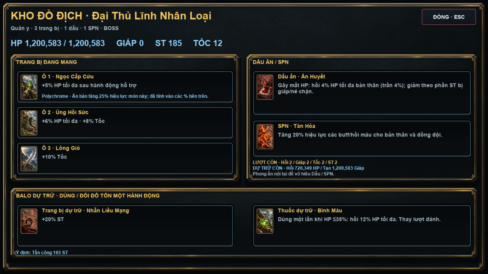

# Kho đồ địch — bản thử đầu tiên

Từng đối thủ có kho đồ độc lập. Nhấn **biểu tượng balo cạnh tên địch** hoặc chuột phải vào lá để xem trang bị, ấn bản, con dấu, SPN và đồ dự trữ. Trên điện thoại có thể chạm cả bảng tên/chỉ số để dễ mở. Esc/Đóng/chuột phải đóng bảng; phím đánh bài bị chặn khi đang xem. ST và tốc nằm chung với tên/HP phía trên lá; dưới chân địch giữ trống, đội hình nhiều người chỉ hiện nhãn hành động nhỏ.

ST hiển thị đỏ, tốc xanh nước với số đậm. Thanh HP/giáp có số và % còn lại; % giáp tính theo lượng giáp tối đa đã có trong trận. Khi số dài, thanh hiện số hiện tại và % để không xuống dòng; kho đồ vẫn cho xem HP tối đa đầy đủ.

## Sinh đồ và cân bằng

- Chỉ số nền và độ khó tăng theo ải tích lũy như trước. Không đọc HP/AURA hay bộ bài của người chơi để tăng sức mạnh địch.
- Vai trò Đấu sĩ, Hộ vệ, Quân y được phân theo ải, số trận và vị trí đội hình; hỗ trợ đầu tiên ưu tiên sát thương, giáp, tốc tương ứng. Khi có người bị thương còn ≤65% HP, vẫn ưu tiên chữa trị.
- Mỗi món có chi phí sức mạnh. Ngân sách tăng mỗi bảy ải, tối đa ba nấc: thường `1 + 2 × nấc`, tinh anh `3 + 3 × nấc`, Boss `5 + 5 × nấc`.
- Thường tối đa một trang bị; tinh anh hai và một SPN hoặc con dấu; Boss ba, có thể có cả dấu lẫn SPN. Tinh anh có SPN từ ải 8, Boss từ ải 4 nếu đủ ngân sách.
- Hiệu lực phần trăm tăng dần tới 100% thông số cấu hình tại ải 20, dừng ở 120%. Tiến trình tiếp theo tăng chỉ số nền, không tăng số đồ hoặc hệ số vô hạn.
- Ấn bản tốn ngân sách: từ ải 5 có Foil (+10% hiệu lực món); ải 12 Holographic (+20%); ải 20 Polychrome (+25%). Một món có một ấn bản. Ví dụ Nhẫn +20% ST có Polychrome trở thành +25% ST, không nhân toàn bộ chỉ số địch.
- Tổng phần trăm trang bị cộng trên cùng chỉ số: tối đa +20% HP nền, +40% ST, +20% tốc (tốc toàn game tối đa 999), giáp đầu trận 20% HP tối đa, hồi từ trang bị 8% HP tối đa sau hỗ trợ.
- Giáp từ hành động hỗ trợ và dấu/SPN giữ trần 50% HP tối đa. Buff tốc/ST giữ quy tắc thời hạn hai hành động và làm mới, không tự nhân chồng.

## Nội dung đang hỗ trợ

Dùng lại tên/tranh của catalog người chơi với quy tắc dành riêng cho địch; không chạy callback tính điểm Poker của người chơi trên quái.

| Trang bị | Hiệu lực tại ải 20, chưa có ấn bản |
| --- | --- |
| Búa Thăm Dò | +15% ST |
| Nhẫn Liều Mạng | +20% ST |
| Đá Thủ Thế | Giáp đầu trận bằng 10% HP tối đa |
| Áo Hộ Mệnh | +12% HP tối đa |
| Lông Gió | +10% tốc |
| Ngọc Cấp Cứu | Hồi 4% HP tối đa sau hỗ trợ |
| Ủng Hồi Sức | +6% HP tối đa, +8% tốc |

| Dấu / SPN | Hiệu lực tại ải 20 |
| --- | --- |
| Ấn Giáp | Sau hỗ trợ: thêm giáp bằng 6% HP tối đa |
| Ấn Huyết | Gây mất HP: hồi 4% HP tối đa địch, giảm theo tỉ lệ sát thương thực gây ra / sát thương đòn; trần 4% mỗi đòn |
| Ấn Phá Giáp (`seal_sunder`) | 15% sát thương của đòn trúng xuyên giáp người chơi |
| Tàn Hỏa | +20% hiệu lực buff/hồi máu được thi triển |
| Băng Vệ | Sau hỗ trợ: thêm giáp bằng 6% HP tối đa |
| Dội Lôi | Mỗi đòn thứ ba dự kiến: +20% ST từ chỉ số sau trang bị, hiện Vọng Âm trong ý định; đòn vẫn có thể hụt |

Dấu và SPN của Boss bị tắt khi nội tại bị phong ấn. Trang bị vật lý vẫn hoạt động; giáp đã tạo ra vẫn có thể bị phá/tiêu hao. Hụt không kích hoạt hút máu/xuyên giáp; ngủ hoặc khóa hành động không dùng đồ hay kích hoạt hỗ trợ. Tổng giáp thêm từ dấu và SPN sau một hỗ trợ giới hạn 10% HP tối đa.

## Balo dự trữ

- Khi đủ ngân sách, Boss từ ải 8 có một món dự trữ đối lập vai trò. HP còn ≤50% sẽ báo trước đổi món ở ô đầu. Đổi tốn hành động, không đánh cùng lúc, không hồi HP khi đổi và không lặp đổi lại đồ đã cất.
- Đối thủ từ ải 8 có thể mang một thuốc hồi 12% HP tối đa (scale theo ải). HP còn ≤35% báo trước dùng thuốc, ưu tiên trước đổi đồ. Thuốc dùng một lần, không hồi sinh.
- Hiệu ứng chỉ thay đổi HP/giáp/đồ khi đến nhịp tiếp xúc trong luồng hành động hiện có. Không tự dùng đồ ngay lúc bị người chơi gây sát thương.

## Chống hồi và buff vô hạn

| Loại địch | Lượt hồi / giáp / tốc / ST mỗi trận | Tổng HP có thể hồi thêm | Tổng giáp có thể tạo thêm |
| --- | --- | --- | --- |
| Thường | 1 / 1 / 1 / 1 | 35% HP tối đa đầu trận | 50% HP tối đa đầu trận |
| Tinh anh | 2 / 2 / 1 / 1 | 50% HP tối đa đầu trận | 75% HP tối đa đầu trận |
| Boss | 2 / 2 / 2 / 2 | 60% HP tối đa đầu trận | 100% HP tối đa đầu trận |

HP tối đa đầu trận đã gồm trang bị. Lượt hỗ trợ thuộc người thi triển; dự trữ hồi/giáp thuộc người nhận. Kỹ năng, hút máu, thuốc, hồi sau hỗ trợ, dấu/SPN và nội tại tái tạo dùng chung dự trữ, nên nhiều Quân y không chữa vô tận cho một Hộ vệ. Dự trữ chỉ giảm theo lượng thực nhận, không hồi lại khi đổi đồ hoặc sang tay mới. Giáp đang có giữ trần 50% HP tối đa; giáp đầu trận không tính vào lượng giáp tạo thêm. Giường và hồi sinh xương vẫn là cứu mạng một lần riêng biệt.

Sau hỗ trợ/uống thuốc/đổi đồ, địch bắt buộc tấn công trước khi hỗ trợ tiếp. Hai lần dùng kỹ năng hồi cần ít nhất hai hành động thực sự xen giữa. Hết lượt hoặc hết dự trữ thì AI chọn hỗ trợ còn dùng được hoặc tấn công; không tự chuyển một chiêu hỗ trợ đã báo trước thành đòn gây sát thương nếu mục tiêu hết dự trữ trước nhịp tiếp xúc. Khóa/ngủ không tiêu lượt hỗ trợ và không kích hoạt trang bị.

Kho đồ hiển thị số lượt từng kỹ năng và lượng dự trữ hồi/giáp còn lại. Hệ số tại `src/enemy_abilities.lua` (`A.limits`).

## One-shot, save và giới hạn bản thử

Không thêm bất tử, chặn sát thương chí tử hoặc giới hạn AURA. Nếu đòn trúng vượt HP và giáp, địch chết ngay (quái xương vẫn giữ hồi sinh sẵn có). Kiểm tra trực tiếp 500.000 AURA hạ các quái thường ải 20 có trang bị; một đòn vượt tổng độ bền vẫn hạ tinh anh/Boss.

Kho đồ sinh ổn định và không tiêu thụ RNG của lượt chơi. Mỗi đối thủ có bảng đồ riêng, không liên kết đồ người chơi. Khởi động lại trận không nhân chồng HP trang bị. Save tại các điểm an toàn dùng hệ thống hiện có; đồ địch chỉ tồn tại trong trận. Chưa thêm rơi toàn bộ kho đồ, mua/ghép đồ cho địch hoặc chuyển đầy đủ catalog người chơi sang hiệu ứng địch. Cần chơi thử nhiều run để chốt cân bằng thực tế.

Chỉnh hệ số, trần và danh mục tại `config/enemy_loadout_data.lua`; sinh đồ và quy tắc sử dụng tại `src/enemy_loadout.lua`.

## Kiểm chứng

- `lovec.exe . --test-enemy-loadouts`: 240 trận; ngân sách và trần, catalog, ấn bản, dấu, SPN, hành động đồ, phong ấn, one-shot, không RNG phụ, tách kho đồ, khởi động lại và save.
- `lovec.exe . --test-combat-tactics`: chính xác, buff, đội hình, nhịp tiếp xúc, thế bài nâng cao và hiệu ứng; tái hiện đánh 7 ST / hồi 7 HP, số lần hỗ trợ từng cấp, dự trữ chung, chờ hồi, bắt buộc tấn công và không làm mới trong trận.
- `lovec.exe . --capture-enemy-loadouts`: mở/đóng bằng các thao tác thật ở 1920 và 960, đổi đồ/uống thuốc ở contact, đòn Poker 500K hạ mục tiêu thật. Ảnh `docs/enemy_loadout_*.png` cách ly save người chơi.
- Hồi quy Continental 52: khả năng bài, Boss, giường, editions và SPN qua; `tests/soul_shop_smoke.lua:133` còn lỗi fixture Ankh/Hex cũ. Đã xác nhận cùng lỗi khi dùng mã combat trước thay đổi này.

