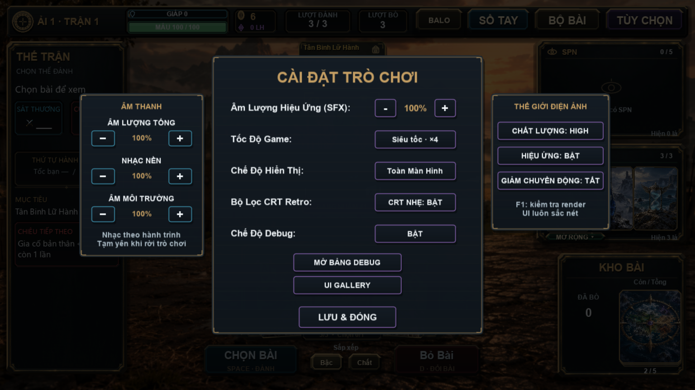

# Tốc độ game

- Nhịp ×1 bằng 65% nhịp cũ, chậm hơn 35% để dễ nhìn các lần kích hoạt và đòn đánh.
- Cài đặt → Tốc Độ Game: nhấn để đổi ×1 → ×2 → ×4 → ×1.
- ×2/×4 tính theo nhịp ×1 mới. Lưu lựa chọn qua lần mở game sau.
- Thiết lập Siêu Tốc cũ chuyển sang ×2. Bỏ nhân đôi riêng từng hiệu ứng để
  tránh cộng dồn thành tốc độ ngoài ý muốn.
- Đồng hồ diễn biến dùng bước nhỏ để ×4 không bị các giới hạn dt của animation
  làm giảm tốc. Điều khiển chuột/cảm ứng, tooltip và âm thanh dùng thời gian thực.
- Không đổi tốc đánh của quân bài, sát thương, RNG, tài nguyên hoặc số lượt.

Kiểm tra:

```powershell
& '..\love-11.5-win64\lovec.exe' .tmp/motion-check tests/game_speed_smoke.lua
& '..\love-11.5-win64\lovec.exe' . --test-game-speed
```

Smoke kiểm tra tỉ lệ tại 30/60/120/144 FPS, giới hạn bước thời gian, đồng hồ
điều khiển/âm thanh, chuyển cài đặt cũ, chu kỳ lựa chọn và nạp lại ×4.
Runtime nhấn nút cài đặt thật và đánh cùng một lá ở ba tốc độ; so thời gian
đến sát thương, sát thương thực và số lượt tiêu thụ.



Chưa kiểm tra trên điện thoại thật.
