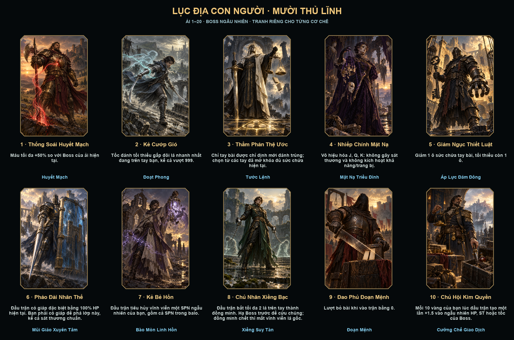
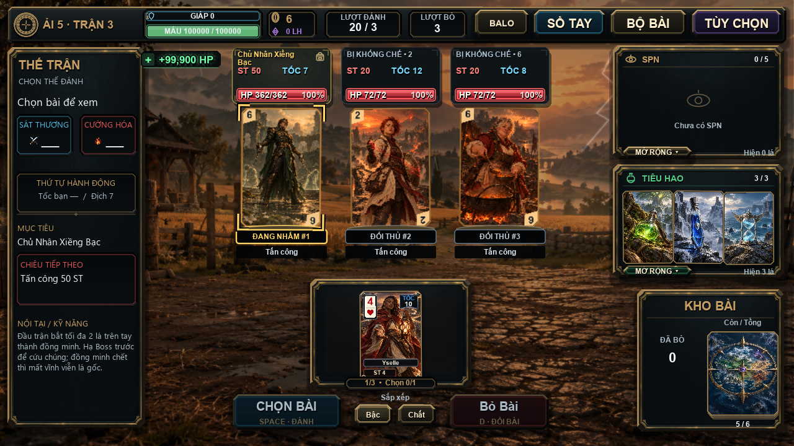

# Mười Boss của Lục Địa Con Người

Màn Boss tại mỗi ải địa phương 1–20 chọn ngẫu nhiên từ các thủ lĩnh đã tới mốc xuất hiện. Boss 1/5 từ ải 1; Boss 3 từ 4; Boss 4/9 từ 5; Boss 2/6 từ 6; Boss 7/8 từ 8; Boss 10 từ 10. Từ ải 10 có đủ cả mười. Không thay bộ Boss của các vương quốc, hải trình, Bí Ẩn hoặc Lãnh Địa Máu. Trở lại khu vực Con Người vẫn dùng bộ này, kể cả chỉ số ải toàn hành trình đã vượt 20. Boss đã chọn và mã trận được giữ khi lưu/tải; chọn Boss dùng nhánh ngẫu nhiên riêng từ seed run, không tiêu các lượt random của thuốc, SPN hay thưởng.

| # | Boss | Nội tại | Kỹ năng |
| --- | --- | --- | --- |
| 1 | Thống Soái Huyết Mạch | HP tối đa +50% sau chỉ số của ải/trang bị. | Mỗi lần thử tấn công, kể cả hụt: hồi 5% HP tối đa. Dùng chung dự trữ hồi của Boss (60% HP tối đa trong trận), không hồi vô hạn. |
| 2 | Kẻ Cướp Gió | Tốc tối thiểu ×2 lá nhanh nhất đang cầm/đang chơi; ngoại lệ cho phép vượt 999. | Đánh trúng: cướp 2 tốc vĩnh viễn từ lá nhanh nhất trong nhóm người chơi đã chọn đánh; tốc lá không dưới 1. Boss nhận phần tốc đã cướp. |
| 3 | Thẩm Phán Thệ Ước | Mỗi đầu tay chỉ định một thế đã mở khóa, đủ sức chứa và ghép được từ các lá đang cầm. Thế khác luôn hụt, kể cả có bảo đảm chính xác. | Đánh trúng, kể cả bị giáp hấp thụ: lập tức bỏ tối đa 2 lá còn giữ; vẫn chạy sự kiện bỏ bài như bình thường. |
| 4 | Nhiếp Chính Mặt Nạ | J/Q/K không tính điểm riêng, không kích hoạt khả năng hoặc trang bị; áp dụng cả Bích. | Đánh trúng: biến một lá còn giữ thành J/Q/K. Chỉ biến bản trong trận, không sửa rank gốc; khôi phục khi rời/kết thúc trận. |
| 5 | Giám Ngục Thiết Luật | Sức chứa tay −1, tối thiểu 1; không sửa chỉ số sức chứa vĩnh viễn. | ST đòn đánh nhân số lá thực đang giữ tại lúc đánh, tối thiểu ×1; năm lá là ×5. |
| 6 | Pháo Đài Nhân Thế | Lớp giáp đầu trận =100% HP hiện tại, tạo một lần. Chưa có giáp thì mọi sát thương, kể cả chuẩn, không phá được lớp này. | Đánh xuyên giáp người chơi nhưng không xóa giáp đang có. Các chặn độc lập như thuốc né/HP ảo vẫn hoạt động. |
| 7 | Kẻ Bẻ Hồn | Đầu trận phá vĩnh viễn 1 SPN ngẫu nhiên trong ô đang dùng hoặc balo, nếu có. | Mỗi lần thực mất HP: SPN ngẫu nhiên giảm 1 cấp tiến hóa; nếu chưa tiến hóa thì giảm 1 bậc nền. Không dưới Thường. Phong ấn chủ động chặn phản ứng này. |
| 8 | Chủ Nhân Xiềng Bạc | Bắt tối đa 2 lá đang giữ thành đồng minh địch. Luôn để lại ít nhất một quân bài còn chơi được trong bộ. Đồng minh có 20% HP và 40% ST của Boss, tốc theo lá gốc. | Đánh trúng: giảm vĩnh viễn 1 cấp tiến hóa của một lá đang giữ còn cấp để giảm; không đổi rank, không giảm dưới 0. |
| 9 | Đao Phủ Đoạn Mệnh | Vào trận với 0 lượt bỏ bài, sau các hiệu ứng mở màn. | Báo trước **Đoạn Mệnh**, tốn trọn một hành động, dùng đúng một lần: phá vĩnh viễn 1 lá ngẫu nhiên còn trên tay. Nếu đã chơi hết tay trước nhịp tiếp xúc thì không còn mục tiêu và vẫn mất lần dùng. |
| 10 | Chủ Hội Kim Quyền | Chốt vàng người chơi lúc vào trận. Mỗi nhóm 10 vàng thêm ×1.5 vào một chỉ số ngẫu nhiên trong HP/ST/tốc. Không tự nhân chồng khi xem chỉ số; phân bố đã chọn giữ qua lưu/tải. | Mỗi đòn thực gây mất HP: bán một món dự trữ trong balo (trang bị/tiêu hao/SPN), trả giá bán thường vào vàng người chơi. Không lấy đồ trong ô đang dùng. |

## Con tin và thay đổi vĩnh viễn

Lá bị bắt không bị nhân bản: lấy khỏi các cọc chơi trong trận nhưng vẫn giữ đúng ID trong bộ bài gốc. Nếu đồng minh bị giết, lá gốc được tiêu hủy qua hệ thống hủy bài hiện có và lưu ngay. Khi Boss chết, đồng minh còn sống được trả về; không cần giết chúng để thắng, không tính giải cứu là một mạng hạ địch. Tải lại trận đang dở dựng lại đúng các ID đã bị bắt, không lấy thêm lá mới và không hồi sinh lá đã mất.

Hạ tốc, mất SPN, hạ bậc, bán đồ và hủy bài sửa đúng vật sở hữu/các bản cùng ID rồi lưu. Riêng hóa J/Q/K chỉ sửa bản trong trận. Hai hiệu ứng một lần (phá SPN mở màn và Đoạn Mệnh) có biên nhận theo mã trận, tránh lặp sau tải lại. Test/capture không ghi thay đổi vĩnh viễn vào save người chơi.

Boss 3 hiện yêu cầu thế bài ngay dưới đội hình. Boss 6 hiện thông báo cần giáp khi bạn chưa đáp ứng điều kiện. Bảng trái hiển thị nội tại đúng Boss; rê vào phần này xem đầy đủ kỹ năng. Các mất mát và thay đổi chỉ số có thông báo BOSS trong trận.

HP/tấn công/trang bị vẫn dựa vào ải hiện tại. Chỉ Boss 2 đọc tốc người chơi và Boss 10 đọc vàng theo nội tại đã yêu cầu. Các số cực lớn giữ hữu hạn trong miền số của engine; không thêm chặn sát thương chí tử. Boss 6 có điều kiện phá giáp riêng như mô tả.

Thông số nền theo vai trò: Boss 2 có 80% HP / 80% ST nền; Boss 5 có 90% HP / 65% ST nền trước khi nhân số lá; Boss 6 có 90% HP / 90% ST nền trước lớp giáp bằng HP. Boss ở ải 1–3 có 85% ST nền để bù giai đoạn chưa có đủ công cụ. Nội tại +50% HP của Boss 1 vẫn giữ nguyên. Hiệu chỉnh áp dụng sau trang bị, không nhân chồng khi bắt đầu lại trận.

## Tranh và mã nguồn

- Mười PNG gốc riêng, 1024×1536, không chữ/khung, tại `assets/cards/continental/enemy/human_*.png` (các ID đặt tên theo Boss, không ghi đè bộ quân người thường).
- Loader: `src/enemy_art.lua` và `config/continental_asset_paths.lua`; dùng khung và chỉ số runtime chung.
- Concept/prompt/nguồn: `docs/HUMAN_BOSS_ASSETS.json`, `docs/CONTINENTAL_ASSET_PROMPTS.md`, `docs/asset_manifest.json`.
- Thông số/nội dung: `config/human_boss_data.lua`; cơ chế: `src/human_bosses.lua`; tích hợp tại các điểm bắt đầu trận, phát đòn, nhận sát thương và kết thúc trận hiện có.

## Kiểm chứng

- `lovec.exe . --test-human-bosses`: mười cơ chế, 200 lựa chọn Boss, giới hạn khu vực, RNG độc lập, hồi hữu hạn, tốc vượt 999, hạ tốc/hạ cấp/hủy vĩnh viễn, khóa thế bài, hóa tạm, giáp đặc biệt, giải cứu và biên nhận lưu/tải.
- `lovec.exe . --capture-human-bosses`: tải đủ mười tranh qua loader và render gallery bằng khung chung.
- `lovec.exe . --capture-human-boss-combat`: mười cuộc chạm trán thật, cảnh nền/tranh/đội hình/UI, thông báo thế bài/giáp, con tin và nhịp tiếp xúc thực của hành động.
- Hồi quy combat/đội hình/kho đồ đi kèm. Bộ Continental rộng còn lỗi fixture Ankh/Hex đã biết tại `tests/soul_shop_smoke.lua:133`.

