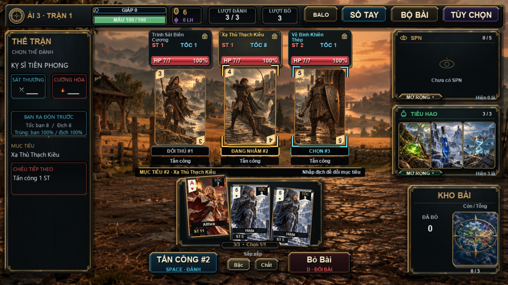
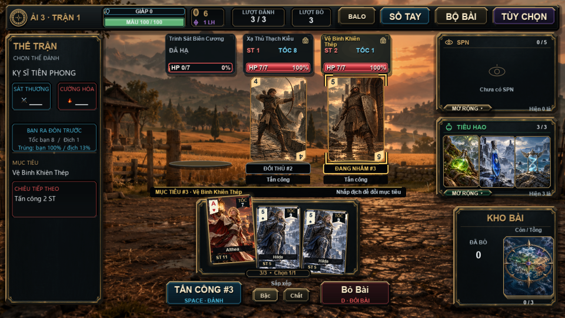
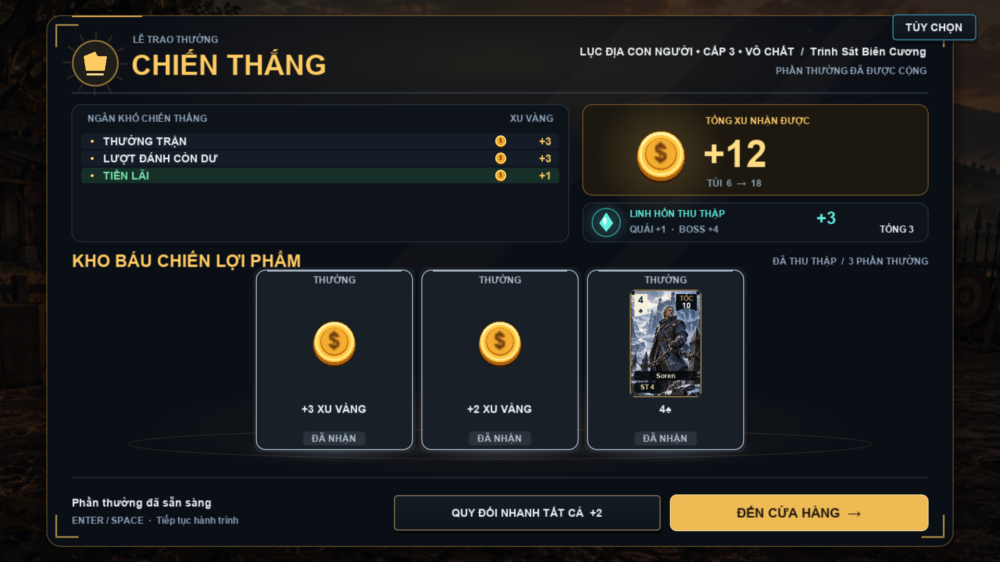
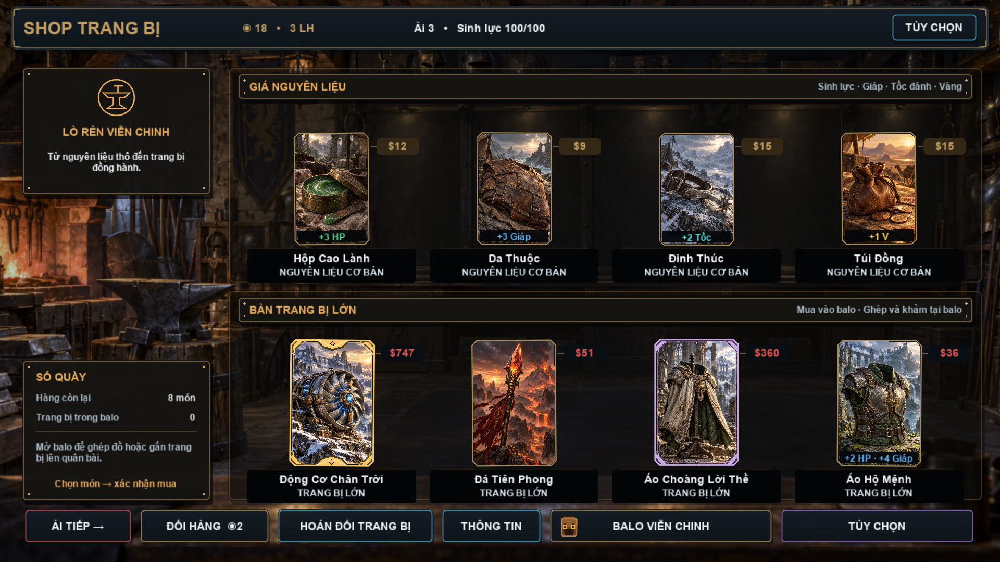

# Đọc rõ mục tiêu và giao diện chiến đấu

Tham chiếu: `CHONDOITUONG.mp4` người dùng gửi, dài 49,43 giây,
1918×1078, 30 FPS. Đã xem toàn bộ chuỗi khung hình, kiểm tra cận cảnh
đoạn chọn địch, sau khi hạ địch, trao thưởng và cửa hàng.

## Vấn đề trong video

- 0–8 giây: dấu vàng dưới chân và màu viền gần với tranh/nền vàng nâu.
  Rất khó phân biệt lá đang được nhắm với lá còn lại khi đổi mục tiêu nhanh.
- 8–20 giây: tên địch trên thanh chỉ số bị cắt; trạng thái mục tiêu và địch
  đang ra đòn chỉ khác nhau bằng màu. Ô chiêu tiếp theo bên trái khá chật.
- 20–38 giây: sau khi hạ địch, mục tiêu đổi sang địch sống nhưng thiếu nhãn
  xác nhận rõ. Tooltip quân bài có thể che vùng thao tác phía dưới.
- 40–46 giây: nền chiến trường xuyên qua bảng chiến lợi phẩm làm giảm tương
  phản chữ. 48 giây: nhãn đồ trong shop nhỏ và chìm vào cảnh lò rèn.

## Thay đổi

- **Mục tiêu đã chọn:** bốn góc nhắm vàng có nền nét tối, nhãn `ĐANG NHẮM #n`,
  thanh xác nhận tên đầy đủ dưới đội hình. Nút đánh ghi `TẤN CÔNG #n` khi đã
  chọn bài; số này trùng với số trên mục tiêu.
- **Rê chuột:** góc nhắm xanh và nhãn `CHỌN #n`, không tự đổi mục tiêu.
  Phân biệt được hai trạng thái bằng chữ, ngoài khác biệt màu sắc.
- **Độ nét:** dấu nhắm vẽ trên canvas UI, sau xử lý ánh sáng/cảnh nền. Vị trí
  lấy từ bốn góc mặt bài sau toàn bộ xoay, co giãn, camera và recoil; không
  vẽ một khung cố định còn sót lại ở ô ban đầu.
- **Điều khiển:** nhấp mặt bài hoặc tên/HP để chọn địch. Biểu tượng túi mở
  kho đồ; chuột phải trên mặt bài vẫn mở chi tiết. Khóa đổi mục tiêu trong
  lúc giải quyết đòn; không chọn được địch đã hạ và tự chuyển sang địch sống.
- **Thông tin trận:** tên địch có hai dòng, các nhãn ý định có nền tối,
  HP/giáp giữ giá trị tối đa nếu font nhỏ còn đủ chỗ. Tên mục tiêu và chiêu
  tiếp theo ở cột trái có thêm chỗ để xuống dòng.
- **Tooltip bài:** quân bài ở vùng dưới ưu tiên đặt mô tả phía trên hàng nút.
- **Chiến lợi phẩm:** tăng độ đậm bảng và màn che để chữ/số không lẫn nền.
- **Shop:** thêm nền tối cho nhãn tên và loại đồ; bỏ thu nhỏ chữ theo một tỉ
  lệ lẻ, dùng font đúng kích thước và chuyển cỡ nhỏ khi cần.
- **Đổi kích thước cửa sổ:** dựng lại canvas chỉ số của bài địch để tránh
  tranh bị trắng sau khi chuyển giữa 960×540 và 1920×1080.

Giữ luật sát thương, lượt, giá, phần thưởng và tranh Continental hiện có.
Dữ liệu hình học chỉ nằm trong bộ nhớ trình bày, không ghi vào save.

## Kiểm chứng

- `--test-target-clarity`: input thật qua mặt bài, bảng tên và túi đồ; hover
  không đổi mục tiêu; khóa khi giải quyết đòn; địch chết/tự chuyển mục tiêu;
  kiểm tra góc nhắm bám hình học mặt bài và ảnh địch còn sau resize.
- `--test-card-motion`: viền/dấu nhắm bám phép biến đổi khi tấn công và recoil.
- Smoke test enemy motion, combat tactics, reward ceremony và kéo chọn bài.
- `--capture-shop --capture-combat-ui`: qua trận thường/đội hình/boss, tạm
  dừng và tiếp tục, HP theo thời điểm trúng đòn, thanh HP trễ, các nút và
  ánh xạ chuột ở 960×540 / 1920×1080.
- Các bài kiểm tra dùng fixture riêng, không ghi save người chơi. Video là
  bản lấy mẫu từ renderer, không phải benchmark FPS trên thiết bị thật.

Chạy:

```powershell
& '..\love-11.5-win64\lovec.exe' . --test-target-clarity
```

[Video chọn mục tiêu](target_clarity_demo.mp4)








